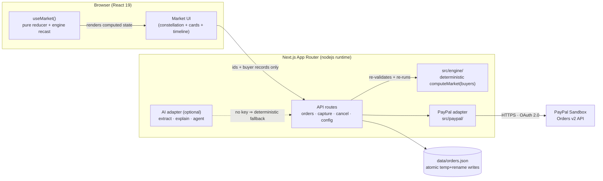
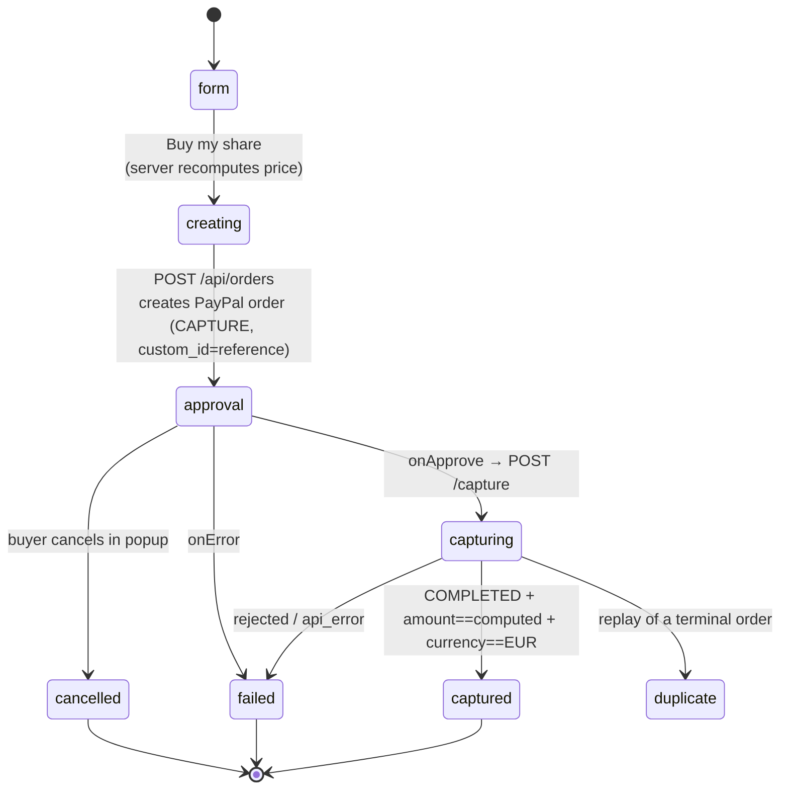
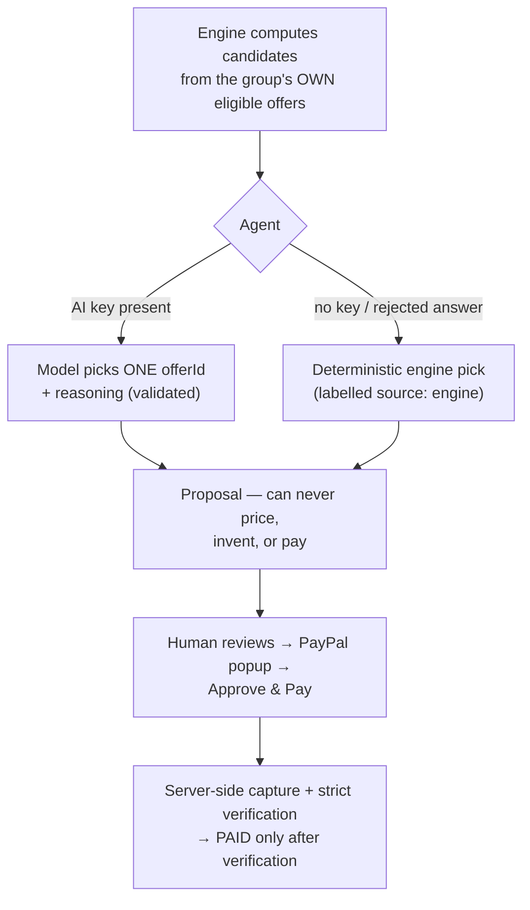

# NeedNet AI — Architecture

**The Market That Forms Around You.** This document is the judge-facing map of how the
system is built: what computes, what decides, who pays, what is verified, and what is
honestly out of scope.

---

## 1. System overview

Two rules hold the whole system together:

1. **The engine owns every number.** Buyers submit ids and validated records; the server
   re-runs `computeMarket` and derives prices itself. No client-computed total is trusted.
2. **The human owns every payment.** Whatever an AI or the engine proposes, only a person
   clicking "Agree & Pay" in a real PayPal popup moves money.

---

## 2. Checkout state machine (Phase 4)

Verification after capture is strict — the internal order flips to `captured` **only** when
the PayPal capture matches all of: order id equality, status `COMPLETED`, capture id
present, amount equal to the server-computed share, currency `EUR`. Cancelled and failed
states are terminal and honest: nothing relabels them as success.

---

## 3. The agentic loop (human-in-the-loop)

The agent is *constrained authority*: it chooses among the engine's computed candidates and
must cite an existing offer id. Invented amounts or unknown ids reject the whole answer.
The timeline records which agent decided (`AI` vs `ENGINE`) — never a fabricated success.

---

## 4. Security & honesty invariants

| Invariant | Where enforced |
|---|---|
| Client secret never crosses a client boundary | read only in `src/paypal/` + nodejs API routes; browser gets `clientId` via a public gate that refuses `live` |
| Server-computed price is the only price | `POST /api/orders` re-runs `computeMarket`, uses `perBuyerCost[buyerId]` |
| Strict capture verification | `POST /api/orders/[reference]/capture` — id, status, amount, currency all checked |
| Idempotency | terminal states replay their recorded result (`duplicate: true`); no double purchases |
| Rate limits | in-memory fixed-window, per IP, per route; friendly 429 copy |
| AI output can't touch state unvalidated | coercion + facts-validation; fallback explanation is always available and truthful |
| Secrets never committed | `.env` git-ignored; secret-scan before every push |

---

## 5. Honest scope (what this demo is NOT)

- One buyer pays **their individual share of one simulated offer** — there is no escrow,
  split payment or grouped settlement.
- Sellers are simulated strategy profiles; a Sandbox capture is a payment **simulation**.
- Order persistence is a local, atomic `data/orders.json` — enough for the demo machine,
  not a deployed database.
- Session market state is in-memory by design: reload resets; **Reset Demo** is exact.

See `README.md` for the full walkthrough of matching weights, offer ranking, natural
language handling and the manual QA checklist.
