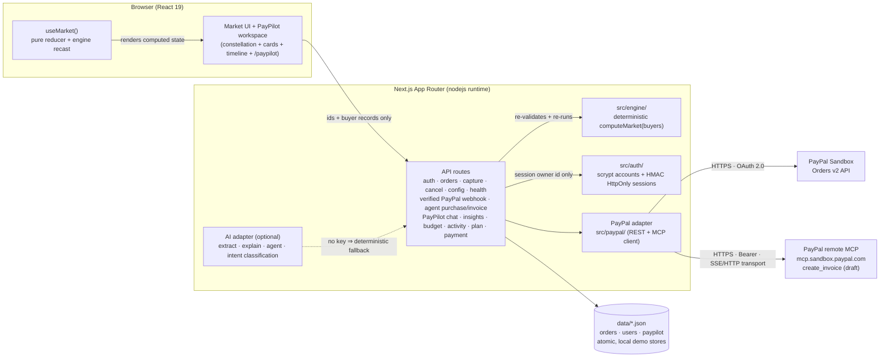
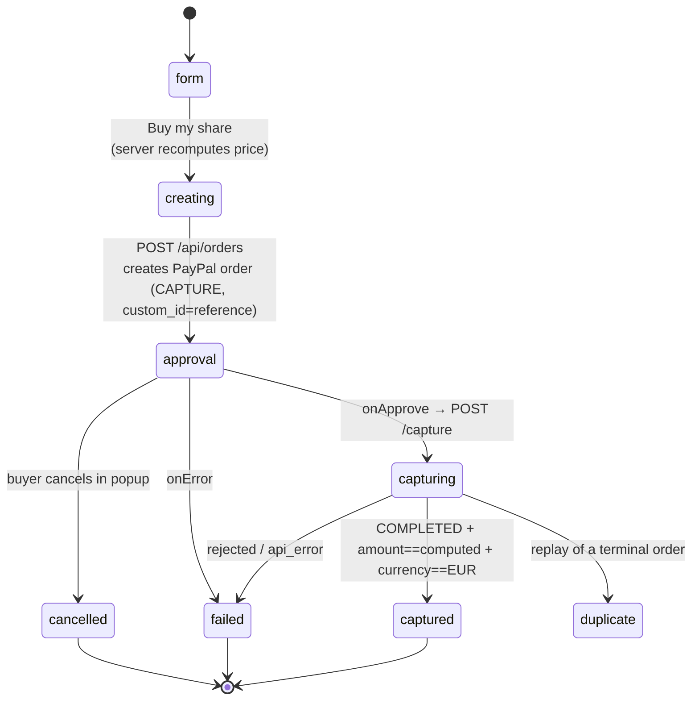
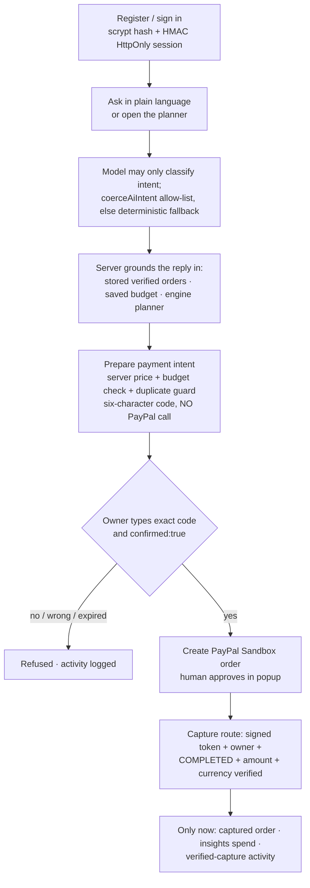
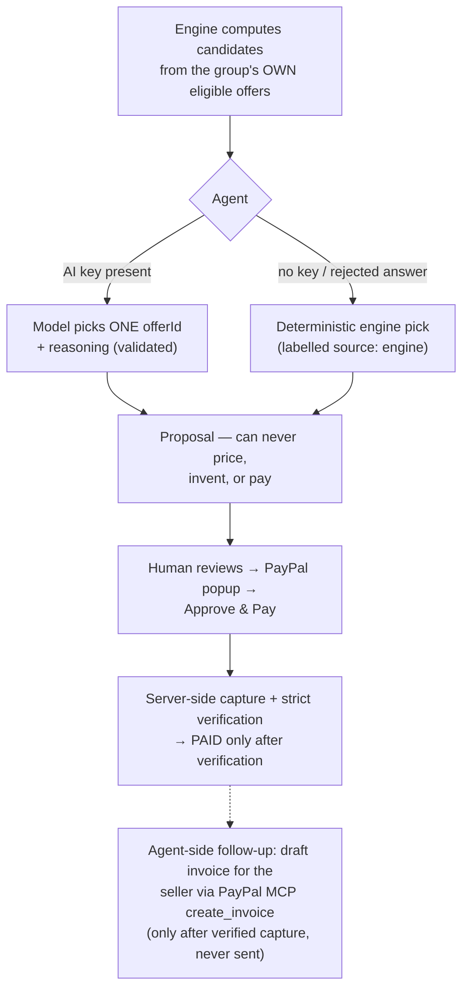

# NeedNet AI — Architecture

**The Market That Forms Around You.** This document is the judge-facing map of how the
system is built: what computes, what decides, who pays, what is verified, and what is
honestly out of scope.

---

## 1. System overview

Two rules hold the whole system together:

1. **The engine owns every number.** Buyers submit ids and validated records; the server
   re-runs `computeMarket` and derives prices itself. No client-computed total is trusted.
2. **The human owns every payment.** Whatever an AI or the engine proposes, only a person
   clicking "Agree & Pay" in a real PayPal popup moves money.

---

## 2. Checkout state machine (Phase 4)

Verification after capture is strict — the internal order flips to `captured` **only** when
the PayPal capture matches all of: order id equality, status `COMPLETED`, capture id
present, amount equal to the server-computed share, currency `EUR`. Cancelled and failed
states are terminal and honest: nothing relabels them as success.

A rejected capture is never immediately accepted as final: the route reads the order back
with PayPal Orders v2 GET. A `COMPLETED` capture with matching amount/currency is recovered
as paid (the `ORDER_ALREADY_CAPTURED` retry case); a read-back that cannot be reached leaves
the order retryable instead of recording a false failure. Asynchronously, the optional
`POST /api/paypal/webhook` verifies every event through PayPal's
`verify-webhook-signature` API before reconciling the vault, so a lost browser response
cannot silently strand a paid order.

---

## 3. PayPilot AI — account-scoped payment intelligence

PayPilot is a separate account-scoped workspace (`/paypilot`) from the shared demo
`/orders` ledger. The owner id is always derived from the verified session, never from a
request body. Chat can propose a budget but only the explicit `PUT /api/paypilot/budget`
writes one. The planner re-runs the engine and never auto-pays. Payment preparation stores a
short-lived intent and code without calling PayPal; confirmation requires the owner, the
exact code and `confirmed: true`. Capture remains authoritative and ownership-aware: an
account-owned order requires the matching session, while legacy unowned orders keep their
demo behaviour.

Only `captured` order rows (written after a verified capture) contribute to verified spend;
pending orders are reported separately. Budget remaining is a planning figure, explicitly
labelled as **not a bank balance**. The activity log is an audit trail, never a source of
financial truth.

---

## 4. The agentic loop (human-in-the-loop)

The agent is *constrained authority*: it chooses among the engine's computed candidates
and must cite an existing offer id. Invented amounts or unknown ids reject the whole answer.
The timeline records which agent decided (`AI` vs `ENGINE`) — never a fabricated success.

After the capture is verified, `POST /api/agent/invoice` performs the seller-side step: it
calls PayPal's remote MCP server (`https://mcp.sandbox.paypal.com`) with the same sandbox
credentials and asks its `create_invoice` tool to raise a **draft** invoice (send_invoice is
never called). The tool fires only against a proven capture — the vault record, or an
HMAC-signed order token + captureId re-verified with PayPal's Orders v2 GET — using only
server-derived amounts and the configured recipient address. Unreachable MCP, rejected
credentials, tool-level errors and missing configuration each answer a distinct labelled
code (`mcp_unreachable`, `mcp_auth`, `mcp_protocol`, `mcp_tool_error`, `mcp_bad_response`,
`capture_unverified`, `recipient_not_configured`, `mcp_not_configured`); a failure is never
relabeled as a created invoice, and a repeat request replays the same invoice id instead of
raising a second one.

---

## 5. Security & honesty invariants

| Invariant | Where enforced |
|---|---|
| Client secret never crosses a client boundary | read only in `src/paypal/` + nodejs API routes; browser gets `clientId` via a public gate that refuses `live` |
| Server-computed price is the only price | `POST /api/orders` re-runs `computeMarket`, uses `perBuyerCost[buyerId]` |
| Strict capture verification | `POST /api/orders/[reference]/capture` — id, status, amount, currency all checked |
| Idempotency | terminal states replay their recorded result (`duplicate: true`); no double purchases |
| Webhooks are never trusted unsigned | `POST /api/paypal/webhook` calls PayPal `verify-webhook-signature`; cert host is allowlisted; amount/currency must match the server-created order |
| Already-captured retries recover safely | capture re-reads the order via Orders v2 GET; paid only on a verified `COMPLETED` capture, retryable when unverifiable |
| Rate limits | in-memory fixed-window, per IP, per route; friendly 429 copy |
| AI output can't touch state unvalidated | coercion + facts-validation; fallback explanation is always available and truthful |
| Private financial data requires a session | every `/api/paypilot/*` route calls `requireSession`; `/api/orders` scopes authenticated GETs to the owner and anonymous GETs to unowned legacy demo orders |
| Passwords are never stored or returned | `src/auth/password.ts` uses scrypt + per-account salt; public user projections contain no hash/salt |
| Session identity cannot be spoofed | HMAC-SHA256 signed HttpOnly/SameSite cookie; owner id read from the token + re-read user record, never trusted from the body |
| Payment cannot start without explicit confirmation | prepare makes no PayPal call; confirm requires the owner, exact six-character code and `confirmed: true`; capture still requires the human PayPal popup |
| Account-owned capture/cancel is owner-only | capture/cancel routes compare the order/token owner with the matching session; legacy unowned demo orders remain explicit demo behaviour |
| Budget changes require a separate explicit request | chat only returns a proposal; only validated `PUT /api/paypilot/budget` persists a limit |
| Invoice only after a proven capture | `POST /api/agent/invoice` — vault `captured` record, or signed token + captureId re-verified with PayPal; failures carry a labelled `error` + `code` + `mcp` object, never a fake invoice |
| MCP invoice is draft-only & replay-safe | only `create_invoice` is called (`send_invoice` never is); per-process replay cache returns the same invoice id on retries |
| Secrets never committed | `.env` git-ignored; secret-scan before every push |

---

## 6. Honest scope (what this demo is NOT)

- One buyer pays **their individual share of one simulated offer** — there is no escrow,
  split payment or grouped settlement.
- Sellers are simulated strategy profiles; a Sandbox capture is a payment **simulation**.
- Order persistence is a local, atomic `data/orders.json` — enough for the demo machine,
  not a deployed database.
- PayPilot accounts (`data/users.json`) and budgets/intents/activity (`data/paypilot.json`)
  are also local atomic JSON demo stores, not deployed durable identity or financial data.
  There is no email verification, password reset, OAuth, MFA or account-deletion flow.
- The legacy `/orders` page remains a shared demo ledger; anonymous visitors see only
  unowned legacy orders. PayPilot data is per-account and auth-gated.
- Session market state is in-memory by design: reload resets; **Reset Demo** is exact.

See `README.md` for the full walkthrough of matching weights, offer ranking, natural
language handling and the manual QA checklist.
